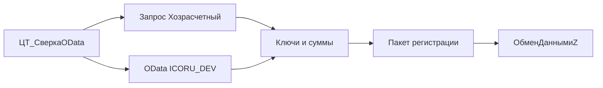

# Сверка ОСВ и регистраторов через OData

Проект [архитектора](df8f6f40-d50e-45c2-8ae6-1b84f1467bfc). Образцы не переписываются: ОСВ и битые ссылки — [ДетальныеВедомости](EMS/DataProcessors/ДетальныеВедомости/Ext/ObjectModule.bsl), обороты по регистратору — [HTTPВыборка](EMS/DataProcessors/HTTPВыборка/Forms/Форма/Ext/Form/Module.bsl), пакет регистрации — [EMS_ИзмененияПланаОбмена](EMS/CommonModules/EMS_ИзмененияПланаОбмена/Ext/Module.bsl).

## Допущение

Обработка живёт на **copyBP**. Свои данные читаются запросом к `РегистрБухгалтерии.Хозрасчетный`, данные УХ — только стандартным OData опубликованной `ICORU_DEV`. Регистрация недостающего выполняется локально на БП: узел `ПланОбмена.ОбменДаннымиZ` и вызывается `ЗарегистрироватьИзмененияПоСообщениям`. Существующий самописный HTTP `hs/sverka/V1/Обороты` для этой сверки не используется.

Публикация `standard.odata` на УХ — внешняя предпосылка (URL и пользователь задаются на форме). Состав публикации: регистр `Хозрасчетный` с функциями виртуальных таблиц, план счетов, `Catalog_Организации`, справочники типов субконто, документы-регистраторы.

## Поток



Ступень 2 запускается только по ключам, где ступень 1 нашла расхождение сумм или отсутствие строки. Порог по умолчанию 0,01, реквизит формы.

## Ступень 1. Суммы ОСВ

Локальный запрос — тот же состав, что `ПолучитьВедомостьХозрасчетный`: счёт, подразделение, валюта, субконто 1–3, развёрнутые остатки и обороты БУ и НУ. Текст запроса копируется в новый серверный модуль, модуль `ДетальныеВедомости` не меняется.

УХ:

```text
GET .../AccountingRegister_Хозрасчетный/BalanceAndTurnovers(StartPeriod=..., EndPeriod=..., Condition='Организация_Key eq guid''...''')?$format=json&$top=1000&$skip=0
```

Один вызов на организацию и период, страницы по `$skip` / `@odata.nextLink`. Код счёта — из кэша `ChartOfAccounts_Хозрасчетный`. Организация УХ переводится в координаты БП через [EMS_КодСопоставленияОрганизации](EMS/InformationRegisters/EMS_КодСопоставленияОрганизации.xml) и `СоответствияОбъектовИнформационныхБаз`.

Ключ строки: `орг | кодСчёта | подразделение | валюта | субконто1 | субконто2 | субконто3`. Ссылочное субконто: `ИмяМетаданных|УИД`. В OData это `ExtDimensionN_Type` и `ExtDimensionN_Key`; отбор по аналитике — `cast(guid'...', 'Catalog_...')`, как в [главе 17](docs/integraciya/глава-17-интеграция-с-внешними-системами.md) для `Balance`.

Справочник к регистрации уже на этой ступени: на БП ссылка заполнена, на УХ ключ пустой или представление «объект не найден» (логика `ОтобратьОбъектНеНайден`). В пакет идёт объект источника.

## Ступень 2. Регистраторы

`Turnovers` стандартного OData не принимает периодичность «Регистратор». Обход без произвольного запроса: на БП — виртуальная таблица `Обороты(, , Регистратор, ...)` по образцу шаблона «бух» в HTTPВыборка; на УХ — `RecordsWithExtDimensions` с узким `Condition` и `AccountCondition` только по ключам ступени 1, затем агрегация движений в ту же гранулярность (измерения плюс регистратор, суммы БУ/НУ/ПР/ВР). Имена функций и полей сумм сверяются по `$metadata` УХ до кодирования запросов: в локальной главе 17 явно показаны `Balance` регистра бухгалтерии и `BalanceAndTurnovers` регистра накопления, `RecordsWithExtDimensions` в этом файле нет.

Ключ регистратора, потому что УИД документа между базами может не совпадать: `орг | кодСчёта | субконто | кодКорСчёта | видДокумента | yyyyMMdd | номер`. Дата и номер на УХ — `$expand=Recorder` либо отдельный GET `Document_*`.

Недостающий документ: регистратор есть в агрегате БП и отсутствует на УХ либо суммы вне допуска. Строка «только на УХ» попадает в отчёт и не регистрируется.

## Регистрация

Пакет для `EMS_ИзмененияПланаОбмена.ЗарегистрироватьИзмененияПоСообщениям`: сначала уникальные `Catalog.*` из аналитики и битых ссылок, затем `Document.*` регистраторов. Ключ документа — JSON `{"Ссылка":"..."}` или `{"Регистратор":"<строка внутр БП>"}`, как уже разбирает модуль. Пачки по 50–100. План счетов, перечисления и сам регистр не регистрируются.

Шаблон `POST /hs/sverka/V1/register-changes` уже объявлен в [ЦТ_HTTP_Сверка.xml](EMS/HTTPServices/ЦТ_HTTP_Сверка.xml) на обработчик `ИзмененияЗарегистрировать`, в [Module.bsl](EMS/HTTPServices/ЦТ_HTTP_Сверка/Ext/Module.bsl) его нет (есть только `ПолучитьОбъектыВыборка`). Для запуска с БП HTTP не нужен. Обработчик дописывается тонкой обёрткой над тем же `ЗарегистрироватьИзмененияПоСообщениям`, чтобы объявленный URL не оставался пустым.

## Новые объекты EMS

- Обработка `ЦТ_СверкаOData`: период, код организации, URL и учётные данные OData, допуск, таблицы расхождений, команды «Сверить» и «Зарегистрировать». Длительная операция по образцу формы `ДетальныеВедомости`.
- Общий модуль `ЦТ_ODataКлиентСервер`: GET, Basic, пагинация, JSON.
- Общий модуль `ЦТ_СверкаODataСервер`: нормализация ключей, обе ступени, сбор пакета.

Префикс `ЦТ_`, совместимость расширения 8.3.14. `ДетальныеВедомости`, `HTTPВыборка` и `EMS_ПроверкаСинхронизации` не меняются.

## Приёмка

- Совпавшая ОСВ не запускает чтение движений.
- Расхождение по счёту читает OData только с отбором этого счёта и аналитики.
- После «Зарегистрировать» документ и связанный справочник стоят в очереди узла `ОбменДаннымиZ` на copyBP.
- Сверка не вызывает `ВыполнитьЗапросВнешний` и `hs/sverka/V1/Обороты`.
