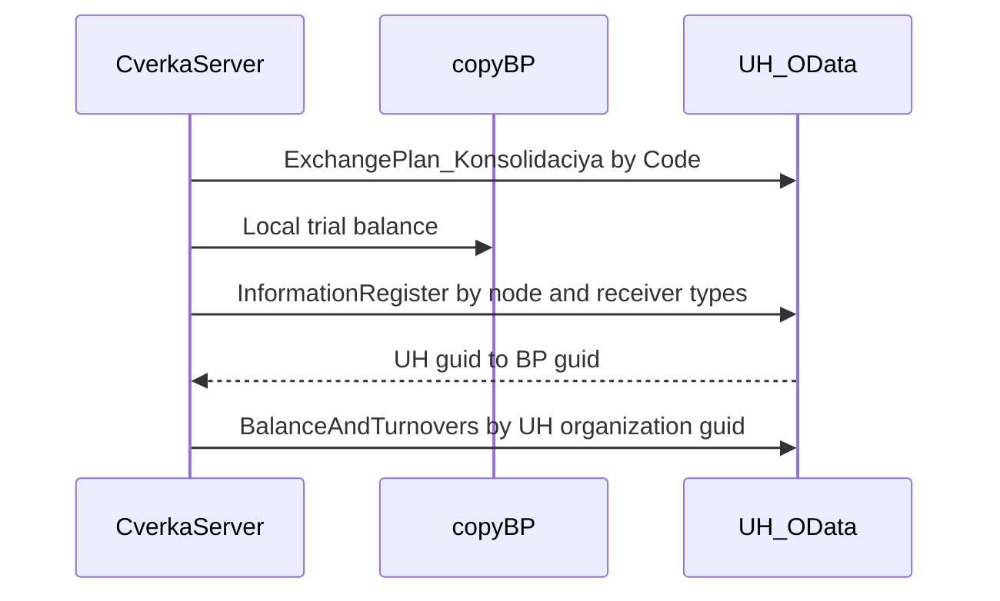

# Соответствия приёмника через OData

Проект [архитектора](97a4e174-1621-4c29-88c1-d450b0a98691). Контракт кэша для сверки не меняется: ключ — GUID объекта УХ, значение — GUID объекта БП. Меняется только источник карты в [ЦТ_СверкаODataСервер](EMS/CommonModules/ЦТ_СверкаODataСервер/Ext/Module.bsl).

## Ориентация полей на УХ

На приёмнике «источник» — объект этой базы, «приёмник» — GUID корреспондента. Это зафиксировано в [СоответствияОбъектовИнформационныхБаз.xml](ICORUHM/InformationRegisters/СоответствияОбъектовИнформационныхБаз.xml) и в перекрёстной записи при загрузке (`КонвертацияОбъектовИнформационныхБаз`, около строк 9665–9670).

- GUID УХ — `УникальныйИдентификаторИсточникаСтрокой`
- GUID БП — `УникальныйИдентификаторПриемника`
- тип БП — `ТипПриемника` (`СправочникСсылка.Организации` и аналоги)

Локальный запрос `КартыСопоставления` к регистру на БП удалён. Ключ кэша — `УникальныйИдентификаторИсточникаСтрокой`, значение — `УникальныйИдентификаторПриемника`. `УидОрганизацииУХ` — строка источника той записи, где приёмник равен `XMLСтрока` организации БП. Пустую строку GUID БП не подменяет.

## Узел

Реквизит `Узел` формы [EMS_СверкаOData](EMS/DataProcessors/EMS_СверкаOData/Forms/Форма/Ext/Form.xml) подписан «Узел источника». Это узел БП: им регистрируются изменения и по коду его предопределённого узла `ЭтотУзел` ищется узел на УХ. Имя плана на УХ — `Консолидация`. Сущности `ExchangePlan_ОбменДаннымиZ` там нет. Смена узла источника очищает `УзелПриемника`.

`УзелДляСоответствий`: если в `УзелПриемника` лежит GUID, берётся он. Иначе один GET по коду источника. Поле `ThisNode` в запрос не входит: standard.odata плана обмена его не публикует и отвечает `400`, `ThisNode path segment is not found`.

```text
GET {АдресOData}/ExchangePlan_Консолидация?$format=json
  &$select=Ref_Key,Code,Description
  &$filter=Code eq '{КодЭтогоУзла}'
  &$top=5
```

Ноль строк — ошибка «На приемнике нет узла источника с кодом …», сверка останавливается. Больше одной строки — ошибка, сверка останавливается.

Поле `УзелПриемника` под узлом источника — необязательный список. Команда `ЗаполнитьУзлы` читает все узлы плана, без отбора `ThisNode`:

```text
GET {АдресOData}/ExchangePlan_Консолидация?$format=json
  &$select=Ref_Key,Code,Description
  &$orderby=Code
  &$top=1000
```

Значение пункта — `Ref_Key`, представление — `Код - Наименование`. Если ровно один код совпал с кодом `ЭтотУзел`, пункт подставляется. Иначе при уже выбранном GUID, которого нет в новом списке, поле очищается. `Зарегистрировать` пишет в `Узел` на БП и узел приёмника не требует.

## Чтение регистра

Один проход на сверку, после локальной ОСВ, до `УдаленнаяОСВ`. Не срез регистра по типу: у узла консолидации такой срез не отвечает за 300 секунд. Берутся GUID из ключей локальной ОСВ и GUID организации. Это измерение `УникальныйИдентификаторПриемника` (строка, индекс). Пачки укладываются в 1500 символов закодированного запроса.

```text
GET {АдресOData}/InformationRegister_СоответствияОбъектовИнформационныхБаз?$format=json
  &$select=УникальныйИдентификаторИсточникаСтрокой,УникальныйИдентификаторПриемника
  &$filter=УзелИнформационнойБазы_Key eq guid'{Ref_Key}'
    and (УникальныйИдентификаторПриемника eq '{GUID БП}')
  &$top=1000&$skip=0
```

Отбор узла по `_Key`. Если публикация отвергнет `_Key`, один повтор порции с `cast`. Таймаут повторно не запрашивается. Ресурс `УникальныйИдентификаторИсточникаСтрокой` в отбор не входит. В тексте таймаута указан адрес набора без параметров.



## Что менять

В [Module.bsl](EMS/CommonModules/ЦТ_СверкаODataСервер/Ext/Module.bsl), область служебных процедур:

- `Сверить`: пустая карта, локальная ОСВ, сбор типов, `ЗагрузитьСоответствияУХ`, затем удалённая ОСВ. В сообщение сверки — код узла `Консолидация`, его `Ref_Key` и число строк кэша.
- Служебные функции: `НовыеКарты`, `КодЭтогоУзла`, `УзелДляСоответствий`, `УзелИсточникаOData`, `УзлыПриемникаOData`, `ТипыПриемникаИзСтрок`, `ТипПриемникаПоИмениOData`, `ПорцииТипов`, `ЗагрузитьСоответствияУХ`, `ПутьСоответствий`, `ДополнитьКартуСтрокой`, `ИмяПланаОбменаУХ`. `УзелИсточникаOData` ищет узел по `Code`. `УзлыПриемникаOData` возвращает массив `Уид, Код, Наименование` без фильтра `ThisNode`.
- Удалить `КартыСопоставления` вместе с локальным запросом.

Не менять: `УидВКоординатахБП`, `КлючПоляOData`, `УдаленнаяОСВ`, `ДвиженияСчетаУХ`, регистрацию, команды «Сверить» и «Зарегистрировать», `ДетальныеВедомости`, `HTTPВыборка`. `EMS_КодСопоставленияОрганизации` не подключать. Форма и `ЦТ_ODataКлиентСервер` меняются только командой проверки связи ниже.

## Приёмка

- В отборе `BalanceAndTurnovers` стоит GUID из `УникальныйИдентификаторИсточникаСтрокой` УХ.
- Пара, которая есть только в регистре БП и отсутствует на УХ, даёт расхождение ключа.
- На время `Сверить` нет запроса БП к `РегистрСведений.СоответствияОбъектовИнформационныхБаз`.
- В HTTP нет `ThisNode`. Поиск узла — `ExchangePlan_Консолидация` с `$filter=Code eq '...'`. Регистр — `InformationRegister_СоответствияОбъектовИнформационныхБаз` с `$filter` по `Ref_Key` этого узла и `ТипПриемника`.
- «Зарегистрировать» ставит объекты в очередь выбранного узла источника на copyBP и узел приёмника не требует.
- «Проверить связь» без узла источника не читает регистр. Узел приёмника может быть пустым: тогда узел УХ ищется по коду `ЭтотУзел`. При успехе сообщение содержит код и `Ref_Key` узла УХ, код `ЭтотУзел` и число записей больше нуля. Пустой регистр — ошибка. ОСВ и страницы регистра не читаются.
- «Заполнить узлы» показывает все узлы плана `Консолидация`. Если выбран GUID из списка, сверка идёт по нему. Если поле пустое, сверка идёт по коду узла источника.

## Проверка связи

Проект [архитектора](ee20e14c-4d3c-46c8-a1d5-43a8c33286ba). Команда формы `ПроверитьСвязь`, заголовок «Проверить связь», рядом с «Зарегистрировать» в `ГруппаКоманды`. Длительной операции нет: два коротких GET, по образцу синхронной «Зарегистрировать».

Идентификатор базы источника в тексте проверки — код предопределённого узла `ЭтотУзел` выбранного плана БП. Его читает `КодЭтогоУзла`: код узла `ЭтотУзел`, а при длине не больше 2 символов — префикс из `ОбщиеНастройкиУзловИнформационныхБаз`. Длина кода плана — 9 символов. Константа `ИдентификаторИнформационнойБазы` в обмен не входит.

1. Узел УХ даёт `УзелДляСоответствий`. Пустой узел источника — ошибка «Укажите узел источника.», счётчик не запрашивается. Пустой `УзелПриемника` ошибкой не является.
2. Один GET количества по `Ref_Key` найденного узла, без страниц. Параметр `$count=true` публикация не поддерживает и отвечает `501`. Количество читается адресом набора `/$count`, в теле ответа только число:

```text
GET {АдресOData}/InformationRegister_СоответствияОбъектовИнформационныхБаз/$count
  ?$filter=УзелИнформационнойБазы_Key eq guid'{Ref_Key}'
```

Число берётся из тела ответа. Если `_Key` отвергнут — один повтор с `cast`. Счётчик 0 — неуспех: связь с узлом есть, регистр на нём пуст.

В [ЦТ_ODataКлиентСервер](EMS/CommonModules/ЦТ_ODataКлиентСервер/Ext/Module.bsl) добавить экспортную `КоличествоЗаписей(ПараметрыПодключения, ОтносительныйПуть)` — один `ВыполнитьЗапрос`, без обхода `nextLink`. Существующие `ПолучитьВсеСтраницы` и `ВыполнитьЗапрос` не менять.

В [ЦТ_СверкаODataСервер](EMS/CommonModules/ЦТ_СверкаODataСервер/Ext/Module.bsl) экспортные `УзлыПриемника(Параметры)` и `ПроверитьСвязьСоответствий(Параметры)`. Обе, как и `Сверить`, получают узел БП и необязательные `УидУзлаПриемника`, `КодУзлаПриемника`. На форме `ЗаполнитьУзлыНаСервере` заполняет список выбора и при единственном совпадении кода подставляет значение. Период, организацию и таблицы сверки проверка связи не трогает.

В [Form.xml](EMS/DataProcessors/EMS_СверкаOData/Forms/Форма/Ext/Form.xml): поле «Узел источника» с `ChoiceButton` и `OnChange`; поле `УзелПриемника` id 99; кнопка `ЗаполнитьУзлы` id 102, команда id 108; кнопка «Проверить связь» id 104, команда id 109. Реквизит `УзелПриемника` id 107. Дубль id 106 у реквизита `Узел` и команды `Сверить` не трогать.

## Автосохранение

Стандартный механизм формы, как в [ПоискГУИДОВиОбъектов](EMS/DataProcessors/ПоискГУИДОВиОбъектов/Forms/Форма/Ext/Form.xml): в заголовке формы `AutoSaveDataInSettings` = `Use` и `SaveDataInSettings` = `UseList`. У сохраняемых реквизитов блок `Save` с именем поля.

Сохраняются четыре реквизита:

- `Период`
- `Узел`
- `АдресOData`
- `ПользовательOData`

Код загрузки и записи в хранилище не пишется. Назначения в `ПриСозданииНаСервере` остаются значениями первого открытия: `Период` — этот месяц, `Допуск` — 0,01. Платформа подставляет сохранённые значения после этого обработчика.

В приёмке: закрыть форму с заполненными периодом, узлом, адресом и пользователем, открыть снова — эти четыре значения на месте. Остальные реквизиты при новом открытии пустые, допуск снова 0,01.
