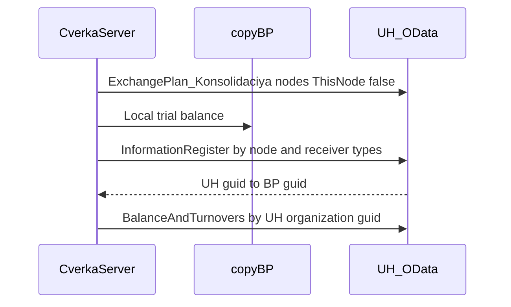

# Соответствия приёмника через OData

Проект [архитектора](97a4e174-1621-4c29-88c1-d450b0a98691). Контракт кэша для сверки не меняется: ключ — GUID объекта УХ, значение — GUID объекта БП. Меняется только источник карты в [ЦТ_СверкаODataСервер](EMS/CommonModules/ЦТ_СверкаODataСервер/Ext/Module.bsl).

## Ориентация полей на УХ

На приёмнике «источник» — объект этой базы, «приёмник» — GUID корреспондента. Это зафиксировано в [СоответствияОбъектовИнформационныхБаз.xml](ICORUHM/InformationRegisters/СоответствияОбъектовИнформационныхБаз.xml) и в перекрёстной записи при загрузке (`КонвертацияОбъектовИнформационныхБаз`, около строк 9665–9670).

- GUID УХ — `УникальныйИдентификаторИсточникаСтрокой`
- GUID БП — `УникальныйИдентификаторПриемника`
- тип БП — `ТипПриемника` (`СправочникСсылка.Организации` и аналоги)

Сейчас `КартыСопоставления` (строки 658–696) читает регистр на БП и кладёт в ключ `УникальныйИдентификаторПриемника`. Для регистра УХ это инверсия: ключ кэша берётся из строки источника, значение — из измерения приёмника. `УидОрганизацииУХ` — строка источника той записи, где приёмник равен `XMLСтрока` организации БП. Пустую строку не подменять GUID БП: сработает уже существующая проверка на строке 42.

## Узел

Реквизит `Узел` формы [EMS_СверкаOData](EMS/DataProcessors/EMS_СверкаOData/Forms/Форма/Ext/Form.xml) остаётся узлом БП для регистрации. Узел регистра соответствий на УХ выбирается отдельно. Имя плана на УХ — `Консолидация`, сущности `ExchangePlan_ОбменДаннымиZ` там нет.

Поле `УзелПриемника` (строка 36, `Ref_Key`) стоит сразу под `Узел`. Режим — список выбора. Команда `ЗаполнитьУзлы` заполняет его одним GET, без длительной операции:

```text
GET {АдресOData}/ExchangePlan_Консолидация?$format=json
  &$select=Ref_Key,Code,Description
  &$filter=ThisNode eq false
  &$orderby=Code
  &$top=1000
```

Значение пункта — `Ref_Key`, представление — `Код — Наименование`. Пустой список — ошибка, сверка не стартует. Если ровно один узел имеет код, равный коду `ЭтотУзел` выбранного плана БП, он подставляется в поле. Иначе поле остаётся пустым, пользователь выбирает сам. Несовпадение кода с `ЭтотУзел` выбор не запрещает: в сообщение сверки и проверки связи пишутся оба кода.

`Сверить` и `ПроверитьСвязь` без выбранного `УзелПриемника` не вызывают регистр. `Ref_Key` выбранного пункта уходит в фильтр регистра. Поиск узла по `Code eq` для этих команд не выполняется. `Зарегистрировать` по-прежнему пишет в `Узел` на БП и узел приёмника не требует.

## Чтение регистра

Один проход на сверку, после локальной ОСВ, до `УдаленнаяОСВ`. Не весь регистр: пачки `ТипПриемника` по 8, страницы через уже существующий `ЦТ_ODataКлиентСервер.ПолучитьВсеСтраницы`. Типы — из ключей локальной ОСВ плюс обязательные `СправочникСсылка.Организации` и `ПланСчетовСсылка.Хозрасчетный`. `Enum_` не грузится. Счета в ключе ОСВ по-прежнему сравниваются по коду; регистратор — по виду, дате и номеру, отдельный проход по документам не нужен.

```text
GET {АдресOData}/InformationRegister_СоответствияОбъектовИнформационныхБаз?$format=json
  &$select=УникальныйИдентификаторИсточникаСтрокой,УникальныйИдентификаторПриемника,ТипПриемника,ТипИсточника
  &$filter=УзелИнформационнойБазы eq cast(guid'{Ref_Key}','ExchangePlan_Консолидация')
    and (ТипПриемника eq '...')
  &$top=1000&$skip=0
```

Если публикация отвергнет `cast` по составному `ExchangePlanRef`, один повторный запрос на сверку с `УзелИнформационнойБазы_Key eq guid'{Ref_Key}'`. Отбор ресурса `УникальныйИдентификаторИсточникаСтрокой` не использовать.



## Что менять

В [Module.bsl](EMS/CommonModules/ЦТ_СверкаODataСервер/Ext/Module.bsl), область служебных процедур:

- `Сверить`: пустая карта, локальная ОСВ, сбор типов, `ЗагрузитьСоответствияУХ`, затем удалённая ОСВ. В сообщение сверки — код узла `Консолидация`, его `Ref_Key` и число строк кэша.
- Добавить неэкспортные `НовыеКарты`, `КодЭтогоУзла`, `УзлыПриемникаOData`, `ТипыПриемникаИзСтрок`, `ТипПриемникаПоИмениOData`, `ПорцииТипов`, `ЗагрузитьСоответствияУХ`, `ПутьСоответствий`, `ДополнитьКартуСтрокой`, `ИмяПланаОбменаУХ`. `УзлыПриемникаOData` возвращает массив `Уид, Код, Наименование`. `ЗагрузитьСоответствияУХ` и `ПроверитьСвязьСоответствий` получают `Ref_Key` выбранного узла, а не ищут его по коду.
- Удалить `КартыСопоставления` вместе с локальным запросом.

Не менять: `УидВКоординатахБП`, `КлючПоляOData`, `УдаленнаяОСВ`, `ДвиженияСчетаУХ`, регистрацию, команды «Сверить» и «Зарегистрировать», `ДетальныеВедомости`, `HTTPВыборка`. `EMS_КодСопоставленияОрганизации` не подключать. Форма и `ЦТ_ODataКлиентСервер` меняются только командой проверки связи ниже.

## Приёмка

- В отборе `BalanceAndTurnovers` стоит GUID из `УникальныйИдентификаторИсточникаСтрокой` УХ.
- Пара, которая есть только в регистре БП и отсутствует на УХ, даёт расхождение ключа.
- На время `Сверить` нет запроса БП к `РегистрСведений.СоответствияОбъектовИнформационныхБаз`.
- В HTTP есть список `ExchangePlan_Консолидация` с `ThisNode eq false` и `InformationRegister_СоответствияОбъектовИнформационныхБаз` с `$filter` по `Ref_Key` выбранного узла и `ТипПриемника`.
- «Зарегистрировать» по-прежнему ставит объекты в очередь выбранного узла на copyBP и не требует узла приёмника.
- «Проверить связь» без узла БП или без выбранного узла приёмника не читает регистр. При успехе показывает код и `Ref_Key` выбранного узла УХ, код `ЭтотУзел` и число записей больше нуля. Пустой регистр — ошибка. ОСВ и страницы регистра не читаются.
- Список узлов показывает все узлы плана `Консолидация`, кроме узла этой базы УХ. Сверка идёт по выбранному пункту, даже если его код не равен коду `ЭтотУзел`.

## Проверка связи

Проект [архитектора](ee20e14c-4d3c-46c8-a1d5-43a8c33286ba). Команда формы `ПроверитьСвязь`, заголовок «Проверить связь», рядом с «Зарегистрировать» в `ГруппаКоманды`. Длительной операции нет: два коротких GET, по образцу синхронной «Зарегистрировать».

Идентификатор базы источника в тексте проверки — код предопределённого узла `ЭтотУзел` выбранного плана БП. БСП отдаёт его из `ИдентификаторЭтогоУзлаДляОбмена` (`acclmcopy/CommonModules/ОбменДаннымиСервер/Ext/Module.bsl`, около строки 3418). Длина кода плана — 9 символов. Константа `ИдентификаторИнформационнойБазы` в обмен не входит. Совпадение этого кода с кодом выбранного узла УХ в сообщение входит, но пустым регистром и чужим кодом управляют разные ветки: чужой код выбор не отменяет.

1. Узел берётся из поля `УзелПриемника`. Если пункт не выбран — ошибка «Выберите узел приёмника.», счётчик не запрашивается.
2. Один GET счётчика по `Ref_Key` выбранного узла, без `ПолучитьВсеСтраницы`:

```text
GET {АдресOData}/InformationRegister_СоответствияОбъектовИнформационныхБаз?$format=json
  &$count=true&$top=1
  &$select=УзелИнформационнойБазы
  &$filter=УзелИнформационнойБазы eq cast(guid'{Ref_Key}','ExchangePlan_Консолидация')
```

Число — из `@odata.count` (запасной ключ `odata.count`). Массив `value` не читается. Если `cast` отвергнут — один повтор с `УзелИнформационнойБазы_Key eq guid'{Ref_Key}'`. Счётчик 0 — неуспех: связь с узлом есть, регистр на нём пуст.

В [ЦТ_ODataКлиентСервер](EMS/CommonModules/ЦТ_ODataКлиентСервер/Ext/Module.bsl) добавить экспортную `КоличествоЗаписей(ПараметрыПодключения, ОтносительныйПуть)` — один `ВыполнитьЗапрос`, без обхода `nextLink`. Существующие `ПолучитьВсеСтраницы` и `ВыполнитьЗапрос` не менять.

В [ЦТ_СверкаODataСервер](EMS/CommonModules/ЦТ_СверкаODataСервер/Ext/Module.bsl) экспортные `УзлыПриемника(Параметры)` и `ПроверитьСвязьСоответствий(Параметры)`. Вторая получает `УидУзлаПриемника`, `КодУзлаПриемника` и узел БП. На форме `ЗаполнитьУзлыНаСервере` заполняет список выбора и при единственном совпадении кода подставляет значение. `ПроверитьСвязьНаСервере` и параметры сверки передают выбранный `Ref_Key`. Период, организацию и таблицы сверки проверка связи не трогает.

В [Form.xml](EMS/DataProcessors/EMS_СверкаOData/Forms/Форма/Ext/Form.xml): поле `УзелПриемника` id 111 и подсказка id 112 под полем `Узел`; кнопка `ЗаполнитьУзлы` id 113; команда id 114. Кнопка «Проверить связь» id 108, подсказка id 109, команда id 110. Дубль id 106 у реквизита `Узел` и команды `Сверить` не трогать.

## Автосохранение

Стандартный механизм формы, как в [ПоискГУИДОВиОбъектов](EMS/DataProcessors/ПоискГУИДОВиОбъектов/Forms/Форма/Ext/Form.xml): в заголовке формы `AutoSaveDataInSettings` = `Use` и `SaveDataInSettings` = `UseList`. У сохраняемых реквизитов блок `Save` с именем поля.

Сохраняются четыре реквизита:

- `Период`
- `Узел`
- `АдресOData`
- `ПользовательOData`

Код загрузки и записи в хранилище не пишется. Назначения в `ПриСозданииНаСервере` остаются значениями первого открытия: `Период` — этот месяц, `Допуск` — 0,01. Платформа подставляет сохранённые значения после этого обработчика.

В приёмке: закрыть форму с заполненными периодом, узлом, адресом и пользователем, открыть снова — эти четыре значения на месте. Остальные реквизиты при новом открытии пустые, допуск снова 0,01.
