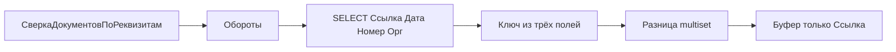

# Упрощенная сверка документов по дате, номеру и организации

Проект [архитектора](14959897-6328-4296-a16b-eb71fd985c59). Область: цепочка «Обороты» для `Тип = "Документы"` в [Module.bsl](EMS/DataProcessors/HTTPВыборка/Forms/Форма/Ext/Form/Module.bsl). `ОбъектыРазница`, регистры, `УпрощенныйВывод` и `МДНаСервере` не меняются.

## Как сейчас

- Для документов `МДНаСервере` кладёт в выборку только `Ссылка` (строки 218–220). Ключ сверки — конкатенация всех полей (`ПолучитьКлючиСтрИзНормализованных`).
- `Обороты` → `ОборотыОбъект` → ветка `Иначе` → `ОбъектыВыборкаОтбор`. Для документов `ИнРег = Неопределено` (1825–1828), поэтому `ПолучитьРазницуПоКлючам` возвращает всю строку, а `СтуктураВИзСтрокиВнутрНорм` вытаскивает из неё все ссылки.
- Организация между базами уже сводится к УИД источника в `ЗначениеДляКлючаСравнения` (3393–3449). Имя реквизита организации у вида — колонка `ВыборкаМетаданные.Организация`, но `ОборотыОбъект` её не берёт и всегда использует `ВыборкаОргРекв`.

## Решение

Флаг формы `СверкаДокументовПоРеквизитам` (чекбокс в группе «Документы», `Группа5` в [Form.xml](EMS/DataProcessors/HTTPВыборка/Forms/Форма/Ext/Form.xml)). Сохранение — как у `УпрощенныйВывод`.

При включённом флаге и `Тип = "Документы"` запрос:

```text
Ссылка, Дата, Номер, <РеквОрг>
```

`<РеквОрг>` — `эл.Организация`, иначе `ВыборкаОргРекв`. Ключ только из трёх реквизитов, значение соответствия — исходная строка. В разницу и в буфер синхронизации уходит **только `Ссылка`** (индекс 0). Если оставить `Индекс = Неопределено`, в буфер попадёт и организация.

Формат ключа: `yyyyMMdd,НОМЕР,#уидОрганизации,`

- Дата: начало дня, формат `ДФ=yyyyMMdd`.
- Номер: `ВРег(СокрЛП(...))`.
- Организация: существующий `ЗначениеДляКлючаСравнения` с картой `УидПриемникаВУидИсточника`. По наименованию не сравнивать.



Дубликаты одного ключа на стороне хранятся массивом, не перезаписываются в `Соответствие`. Сопоставление внутри ключа — по УИД ссылки, парами. Лишние строки уходят в «Л&lt;В» / «В&lt;Л» как сейчас.

Нет реквизита организации в метаданных документа: компонент организации = `ПустойКлючСверки()`, одно предупреждение на вид, строки не отбрасываются.

## Точки правки

Новые функции в том же модуле формы, полный ключ не переписывать:

- `ПоляВыборкиДокументовУпрощенная`
- `РеквизитОрганизацииДокументаДляСверки` — проверка `Метаданные.Документы`
- нормализация даты и номера
- `ПостроитьСоответствияКлючейДокументовУпрощенно` — сервер, ключ → массив исходных строк
- `ПолучитьРазницуПоКлючамСМножеством` — тот же контракт результата, что у `ПолучитьРазницуПоКлючам` при индексе ссылки: массив `[[Ссылка], ...]`

Точечно:

- `Обороты` (~1868): передать `эл.Организация`.
- `ОборотыОбъект` (~1807, ветка `Иначе`): при флаге и `Документы` подменить поля и текст запроса; `ЗапросУсловие` без изменений.
- `ПолучитьРезультат` (~1469, `База = "Разница"`): если флаг и `Рез.Тип = "Документы"`, упрощённые соответствия и сравнение с индексом 0; иначе текущий блок `ПривестиВыборкуКФорматуКлючей`.

При выключенном флаге состав SELECT и ключ остаются «только Ссылка».
